<p align="center">
  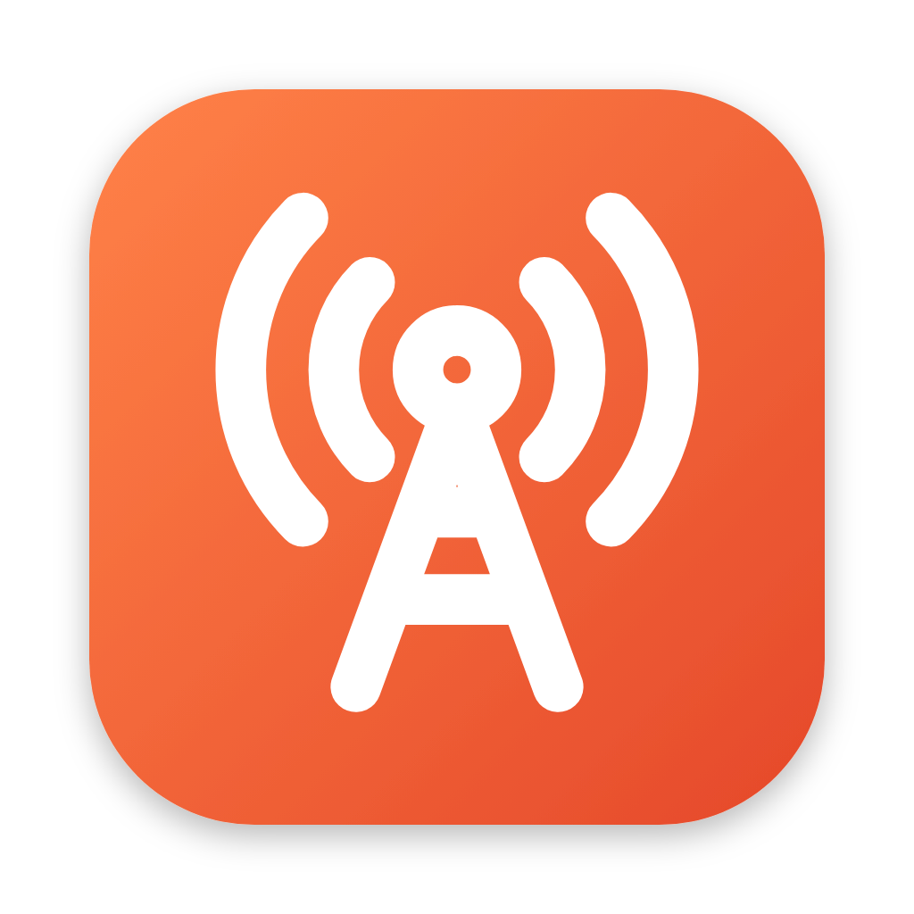
</p>

<h1 align="center">Kerygma Live</h1>

<p align="center">
  Prepara y revisa la <b>transmisión en vivo</b> y las <b>pantallas</b> antes del servicio, en <b>Mac y Windows</b>.<br>
  Abre los programas, configura OBS, prueba internet, audio, cámaras y proyectores, y deja un checklist claro de lo que falta.
</p>

<p align="center">
  <a href="https://github.com/DavidCortesA/kerygma-live/releases/latest"><b>Descargar la última versión</b></a>
  ·
  Hermano de <a href="https://github.com/DavidCortesA/converter-kerygma">Kerygma Converter</a> y <a href="https://github.com/DavidCortesA/keygma-yt-downloader">Kerygma Downloader</a>
</p>

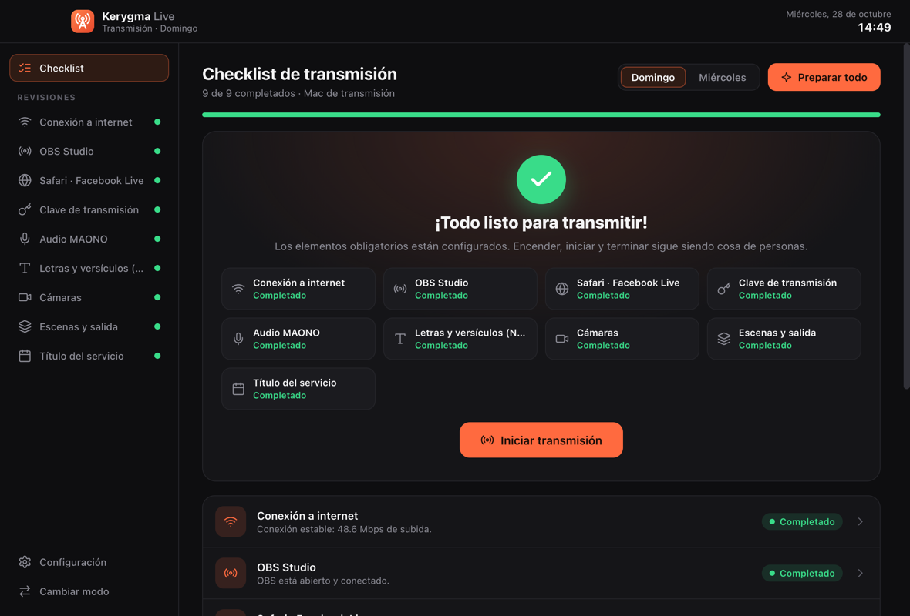

La idea: el equipo de medios llega, pulsa **Preparar todo** y la app hace la configuración básica. Lo que no puede revisar sola (conectar un celular, confirmar que el proyector se ve) queda en el checklist y se marca en cuanto está listo. **Encender, iniciar y terminar la transmisión sigue siendo cosa de personas**: la app nunca sale al aire sin que alguien lo confirme.

## Una app, dos modos

La misma app se instala en cada computadora y cada una revisa lo suyo. El modo se elige la primera vez y se puede cambiar cuando quieras.

| | **Transmisión** | **Pantalla** |
|---|---|---|
| Computadora | La que tiene OBS y el navegador | La que proyecta letras y versículos |
| Revisa | Internet, OBS, la página y la clave, audio, letras por NDI, cámaras, escenas y título | Programa de presentación, pantallas conectadas, escritorio extendido, salida y NDI |

### Modo Transmisión

| Revisión | Qué revisa | Qué hace sola con **Preparar todo** |
|---|---|---|
| **Conexión a internet** | Red local, que respondan Facebook y YouTube, latencia y velocidad de subida contra el bitrate de OBS | — |
| **OBS Studio** | Instalado, abierto y conectado por WebSocket; perfil, colección de escenas y si ya está transmitiendo | Abre OBS y, si su WebSocket está apagado, lo activa antes |
| **Página de transmisión** | En Safari, Chrome o Edge (macOS) lee la pestaña al frente y revisa que sea la página de la iglesia o el Productor en vivo | Abre la página o cambia la pestaña; pide confirmar que publicas **como la página** y no como tu perfil |
| **Clave de transmisión** | Que OBS tenga el servidor y la clave correctos | Pone la clave en OBS (nunca mientras transmite) |
| **Audio** | Que el dispositivo (ej. **MAONO**) esté conectado, que una fuente de OBS lo use, que no entre también el micrófono por defecto, y el nivel de señal | Mide la señal 3 s; con un clic asigna el dispositivo a OBS o silencia el micrófono por defecto |
| **Letras y versículos (NDI)** | Que OBS tenga la fuente NDI de Holyrics/ProPresenter, que el emisor esté en la red y que no llegue en negro | Con un clic crea la fuente en OBS si el emisor está en la red |
| **Cámaras** | Cada cámara: celulares y PTZ por NDI, capturadora HDMI, cámara USB o switcher (ATEM u otro módulo). Que lleguen a OBS y con imagen, con vista previa | Se revisan solas cada pocos segundos: los celulares se pueden conectar al final |
| **Escenas y salida** | Escena al aire, fuentes visibles y ocultas, resolución y fps de salida | Pone al aire la escena de transmisión elegida |
| **Título del servicio** | El del día (Domingo, Miércoles…) | Lo escribe en la fuente de texto de OBS y lo copia para pegarlo en Facebook |

### Modo Pantalla

| Revisión | Qué revisa |
|---|---|
| **Holyrics / ProPresenter** | Instalado y abierto (con ProPresenter, también su API de red si la activas) |
| **Pantallas conectadas** | Cuántas hay contra las esperadas (proyector, TV, receptor inalámbrico, pantalla de retorno), que no estén en espejo y su resolución |
| **Prueba de imagen** | Muestra un patrón con el número y el nombre de cada pantalla, con esquinas para ver si la imagen se recorta |
| **Salida del programa** | Guía para elegir la pantalla de salida en Holyrics, ProPresenter, EasyWorship u OpenLP, y confirmación de que se ve donde debe |
| **Salida NDI** | Red local lista y confirmación de que las letras salen por NDI hacia la computadora de transmisión |
| **Red** | Red local e internet |

### Estados

**Completado** (pasó) · **Atención** (funciona, pero algo conviene mirar) · **Revisar** (falló) · **Pendiente** (falta algo que se conecta después; se revisa solo) · **Confirmar** (necesita que una persona lo vea) · **Omitido** (no bloquea, pero no cuenta como aprobado). El checklist queda **listo** cuando todo lo obligatorio está completado; lo opcional (cámaras, título, red) no lo bloquea.

## Equipos que admite

| | Opciones |
|---|---|
| Programa de transmisión | **OBS Studio** (revisión y configuración automática), Streamlabs, vMix (Windows), Ecamm Live (Mac) u otro |
| Destino | **Facebook Live**, YouTube Live o un servidor RTMP propio |
| Navegador | Safari (Mac), Google Chrome, Microsoft Edge, Firefox |
| Audio | Consola o interfaz USB (MAONO, Focusrite…), mezcladora digital, micrófono USB, audio de la capturadora o el de la computadora |
| Cámaras | Celulares por NDI, cámaras PTZ/IP por NDI, capturadora HDMI, cámara USB, switcher o módulo de cámaras |
| Presentación | **Holyrics**, **ProPresenter**, EasyWorship (Windows), OpenLP u otro |
| Pantallas | Hasta 4 de salida: proyector, pantalla o TV, receptor inalámbrico HDMI, pantalla de retorno |

## Capturas

| Elegir el modo | Asistente: cámaras |
|---|---|
| 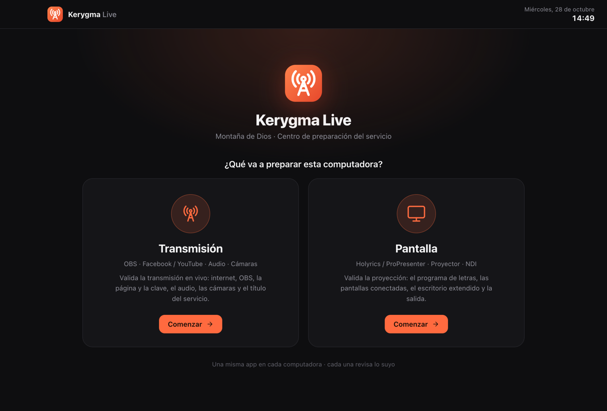 | 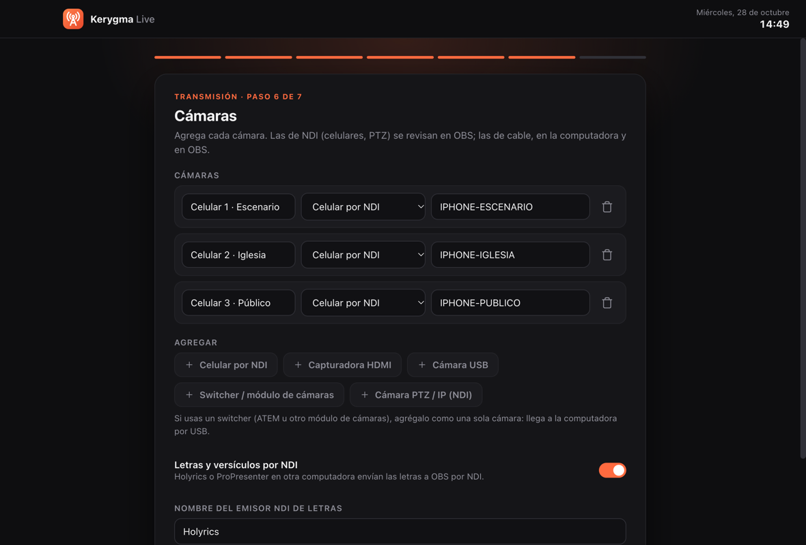 |
| **Checklist a medio preparar** | **Audio MAONO con señal** |
| 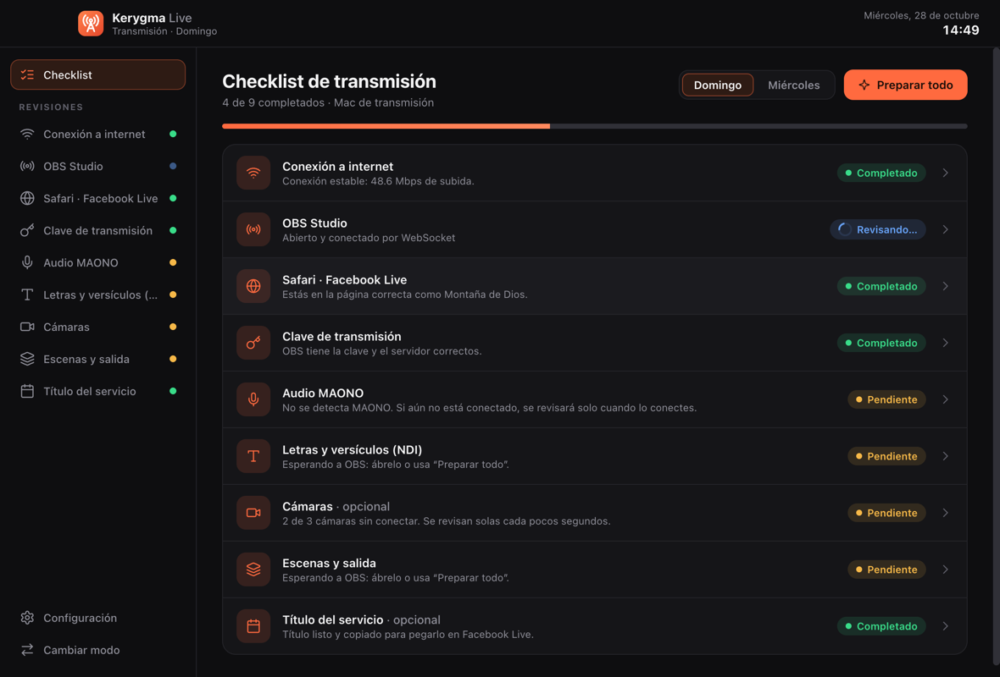 | 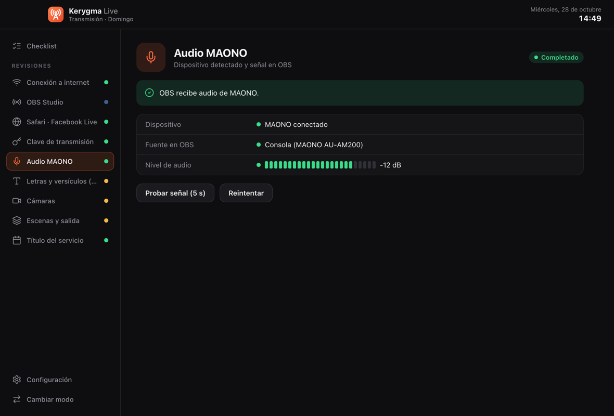 |
| **Cámaras: una conectada, dos pendientes** | **Configuración** |
| 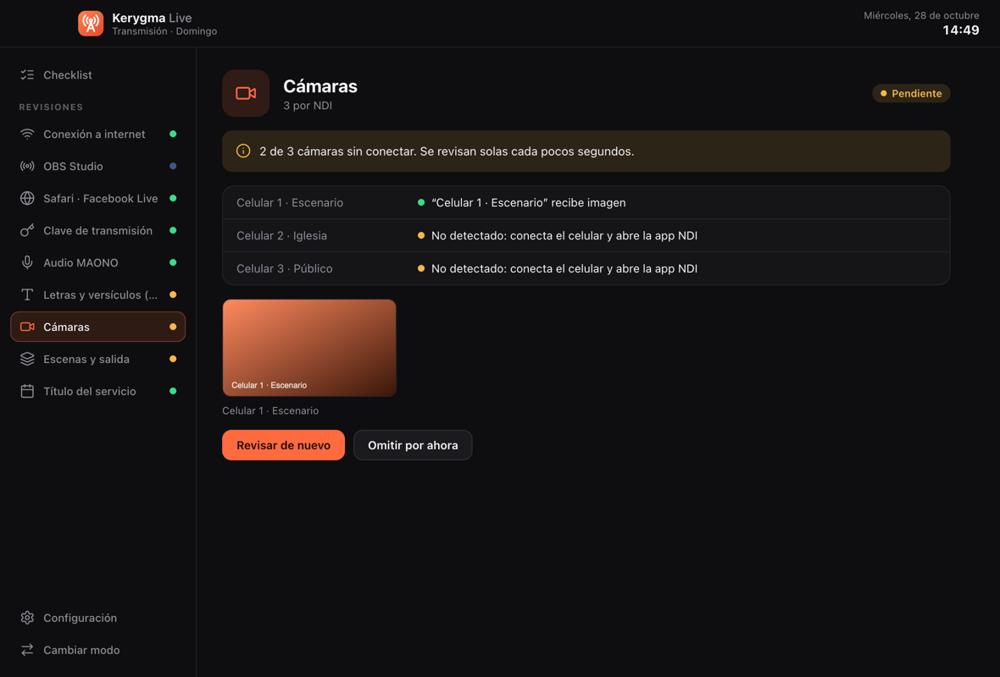 | 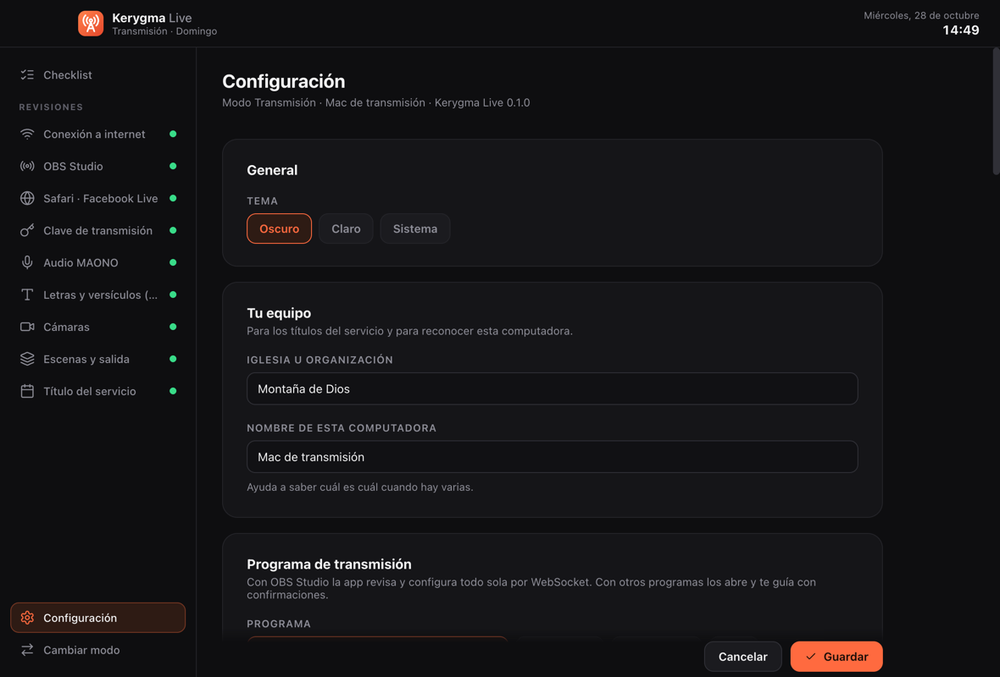 |
| **Modo Pantalla** | **Pantallas conectadas** |
| 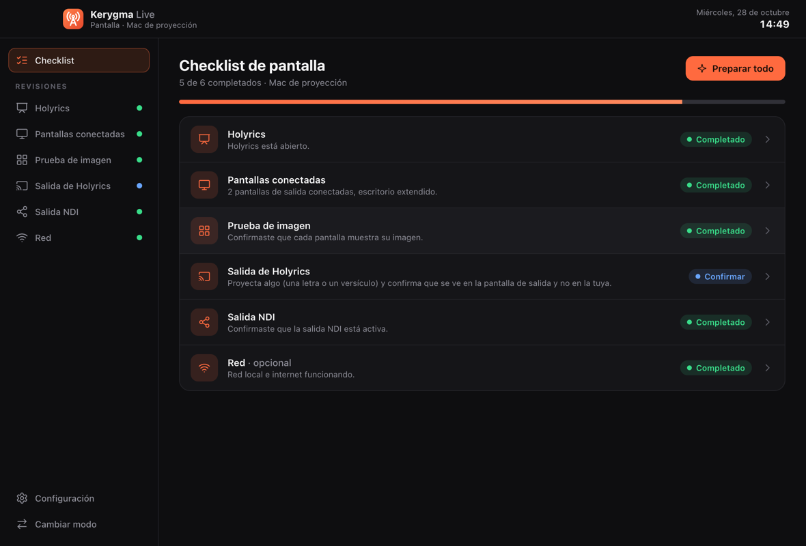 | 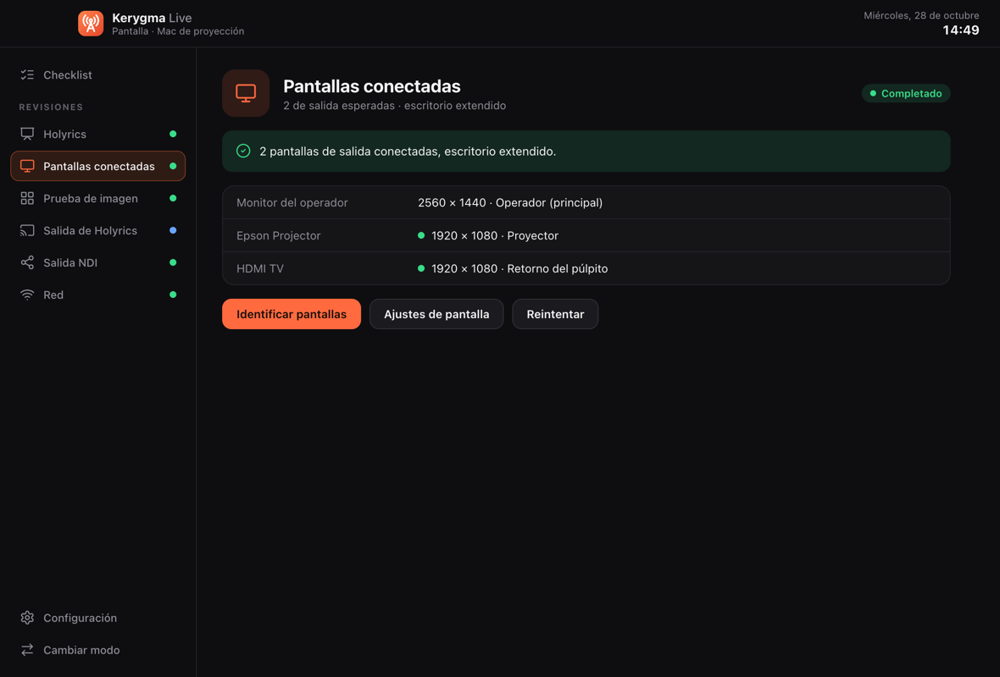 |
| **Tema claro** | |
| 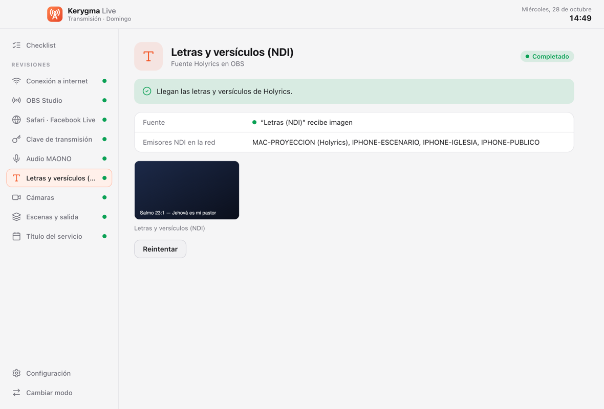 | |

## Primer uso

1. Abre la app y elige el modo de esta computadora. Un asistente pregunta por tu equipo: programa, destino, navegador, audio, cámaras y servicios (o, en modo Pantalla, el programa de presentación y las pantallas).
2. **OBS:** la app lee la conexión del WebSocket del propio OBS, así que no hay que escribir contraseñas. Si el WebSocket está apagado, **Preparar todo** lo activa antes de abrir OBS (o actívalo en OBS → Herramientas → Ajustes del servidor WebSocket).
3. **NDI en OBS:** instala el plugin [DistroAV](https://github.com/DistroAV/DistroAV/releases/latest) y el NDI Runtime. Los celulares usan una app NDI (por ejemplo NDI HX Camera).
4. **Clave de transmisión:** en Facebook, Productor en vivo → **Clave de transmisión persistente**, para que no cambie cada servicio. Se guarda cifrada en el llavero del sistema.
5. **macOS** pide permisos la primera vez: **Automatización** (para leer la pestaña de Safari), **Micrófono** y **Cámara** (para ver los dispositivos).

## Seguridad

- La clave de transmisión y la contraseña de OBS se guardan cifradas con el llavero del sistema (Llavero de macOS / DPAPI de Windows) y nunca llegan a la interfaz ni a los registros.
- Al copiar la clave, se borra del portapapeles al minuto.
- La app no cambia la clave de OBS mientras está transmitiendo, y **Iniciar transmisión** siempre pide confirmación.
- La interfaz no tiene acceso a Node ni a la terminal; solo a las funciones de `preload.js`.

## Descargar la app

| Archivo | Para quién |
|---|---|
| `Kerygma-Live-<versión>-Windows-Instalador.exe` | Windows: se instala con acceso directo en el menú Inicio y desinstalador |
| `Kerygma-Live-<versión>-Windows-Portable.exe` | Windows: se abre directo, sin instalar |
| `Kerygma-Live-<versión>-Mac-Apple-Silicon.dmg` | Mac con chip M1, M2, M3 o posterior |
| `Kerygma-Live-<versión>-Mac-Intel.dmg` | Mac con procesador Intel |

¿No sabes cuál es tu Mac? Menú  → **Acerca de esta Mac**: si dice **Chip Apple M…** es Apple Silicon; si dice **Procesador Intel…** es Intel.

La app no está firmada con certificados de pago:

- **Windows:** si SmartScreen muestra "Windows protegió su PC", haz clic en **Más información → Ejecutar de todas formas**.
- **macOS:** la primera vez macOS dice que *no pudo verificar* la app. Cierra el aviso, ve a **Configuración del Sistema → Privacidad y seguridad**, baja hasta **Seguridad** y haz clic en **Abrir de todos modos**. Si dice que la app **está dañada**: `xattr -cr "/Applications/Kerygma Live.app"` en la Terminal.

## Lo que todavía no hace

- **Cambiar de perfil en Facebook** ni escribir el título en Facebook: la app revisa la página, pide confirmar que publicas como la página y deja el título copiado para pegarlo.
- **Leer la pestaña del navegador en Windows o en Firefox:** ahí la app abre la página y pide confirmarla.
- **Revisar Holyrics por dentro:** detecta si está abierto; que la letra salga en la pantalla correcta se confirma con el patrón y a la vista.
- **Ver una computadora desde la otra:** cada una revisa lo suyo. La de transmisión sí comprueba que lleguen las letras por NDI.
- Versión 0.1: probada en macOS (programas, red y pantallas reales; OBS simulado en las pruebas). Falta probarla con OBS, Holyrics, el MAONO y los celulares reales, y en Windows.

## Desarrollo

Requisitos: Node.js 20 o superior.

```bash
npm install
npm start            # abre la app
npm test             # pruebas sin conexión: configuración, checklist, páginas, pantallas, red y un OBS simulado
npm run screenshot   # captura la interfaz con datos simulados (dist/screenshots)
npm run icon         # regenera el logo, los íconos y las imágenes del instalador
```

> Evita desarrollar dentro de carpetas sincronizadas con iCloud (Documentos o Escritorio en macOS): `codesign` falla ahí al empaquetar.

Para agregar un programa, súmalo a `CATALOG` en `src/core/apps.js`; para una revisión nueva, defínela en `src/core/checklist.js` e impleméntala en `src/main/checks.js`.

## Publicar una versión

```bash
npm run dist:win   # instalador + portable de Windows (en Windows)
npm run dist:mac   # .dmg para Intel y Apple Silicon (en macOS)
```

La arquitectura la deciden `--x64` / `--arm64` en la línea de comandos (no la fijes en `build.mac.target`). La forma recomendada es **GitHub Actions** ([`.github/workflows/build.yml`](.github/workflows/build.yml)): compila en Windows y en los dos tipos de Mac, corre las pruebas y, al subir una etiqueta, crea la Release:

```bash
git tag v0.1.0
git push origin v0.1.0
```

## Arquitectura

```
main.js                     Proceso principal: ventana, IPC, configuración, claves cifradas, patrón de prueba
preload.js                  Puente seguro entre la interfaz y el proceso principal
src/core/                   Lógica sin Electron (se prueba con Node)
  settings.js               Esquema y validación de la configuración
  checklist.js              Qué se revisa en cada modo, estados y servicio del día
  obs.js                    Cliente de OBS WebSocket 5 (sin dependencias) y consultas de audio, NDI, clave y escenas
  obs-config.js             Lee y activa el WebSocket desde el archivo de configuración de OBS
  apps.js                   Encuentra, abre y vigila programas en macOS y Windows
  browser.js                Lee y cambia la pestaña de Safari/Chrome/Edge (AppleScript) y valida la página
  network.js                Red local, latencia y velocidad (speed.cloudflare.com)
  displays.js               Evalúa las pantallas conectadas contra las esperadas
src/main/checks.js          Cada revisión: qué mira, qué arregla sola y qué acciones ofrece
src/renderer/               Interfaz (HTML, CSS y JS sin dependencias) y patrón de prueba
scripts/                    smoke-test, screenshot, make-icon, after-pack
```

## Licencia

MIT.
